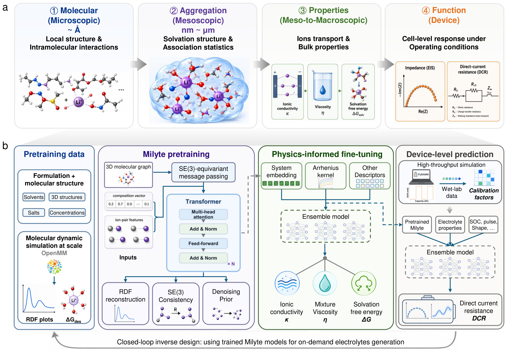

<div align="center">

<h1>Milyte</h1>

<p><b>A Multiscale, Physics-Native Deep Learning Framework<br/>from Molecule to Cell for Electrolyte Property Prediction and Formulation Design</b></p>

[](LICENSE)
[](https://huggingface.co/xiaomi-research/milyte)
[](environment.yml)
[](requirements.txt)
[](#)

<br/>



</div>

---

**Milyte** connects four physical scales of the battery electrolyte — molecular
solvation structure, mesoscopic aggregation, bulk transport properties, and
device-level performance — within a single differentiable model. A Transformer
backbone is pretrained on molecular-dynamics-derived radial distribution functions
(RDFs) under a triple objective (RDF reconstruction, stepwise desolvation
free-energy prediction, SE(3)-equivariant denoising), then finetuned into four
downstream property predictors and inverted for target-conditioned formulation
design (GALO).

> **Data and model policy.** All pretrained
> weights and datasets are hosted separately on Hugging Face:
>
> 🤗 **[huggingface.co/xiaomi-research/milyte](https://huggingface.co/xiaomi-research/milyte)**

## Highlights

| | |
| --- | --- |
| 🧬 **Physics-native pretraining** | RDF reconstruction + stepwise ΔG_des prediction + SE(3)-equivariant denoising, learning the local Li⁺ solvation shell |
| 🔗 **One backbone, four properties** | Ionic conductivity (κ), viscosity (η), desolvation free energy (ΔG), dual-temperature DCR |
| ⚗️ **Up to 7-component formulations** | Mixture-invariant composition encoding + Arrhenius-inspired temperature kernel |
| 🎯 **Inverse design (GALO)** | Gradient ascent over the composition simplex + local refinement — target property → candidate recipe |
| ✅ **Reproducible evaluation** | Consistent 5-fold cross-validation across all property models |

## Repository layout

```
milyte/
├── README.md                  # This document
├── LICENSE                    # Apache License 2.0
├── environment.yml            # Conda environment definition (recommended)
├── requirements.txt           # pip dependencies (shared by both stages)
├── data/                      # Local mount point, populated from Hugging Face (not tracked in Git)
│   ├── checkpoints/           # Pretrained RDF backbone: best_model.pt, config.json, vocab/mol files
│   ├── pretrain/              # Pretraining data: pretrain_rdf_{train,val,test}.csv
│   └── downstream/            # Finetuning/evaluation data and split artifacts
│       ├── conductivity.csv / viscosity.csv / free_energy.csv / dcr.csv
│       └── mol_columns.json / ion_pair_vocab.json
├── src/
│   ├── pretrain/              # Stage I: RDF pretraining
│   │   └── train_config.yaml  # Single source of truth for pretraining
│   └── downstream/            # Stage II: downstream finetuning + evaluation
│       └── models/
│           ├── common/                           # Shared base: components / data / losses / arch / metrics
│           ├── rdf_backbone.py                   # RDF pretrained backbone + pretraining entry
│           ├── conductivity_predictor.py         # Conductivity prediction
│           ├── free_energy_predictor.py          # Desolvation free energy prediction
│           ├── viscosity_predictor.py            # Viscosity prediction
│           ├── dcr_dual_temperature_predictor.py # Dual-temperature DCR prediction
│           ├── train_dcr_dual_temperature.py     # DCR training entry
│           ├── recipe_inference.py               # Recipe → property inference helper
│           └── inverse_design.py                 # Inverse design (GALO): recipe for a target property
├── .gitignore                 # data/ and model weights are intentionally untracked
└── tests/
    ├── test_smoke.py          # Layout, artifact presence, entry-point imports
    └── test_pipeline_contracts.py  # Config/CSV/CLI/architecture contract checks (CPU)
```

## Data and model availability

The `data/` directory shown above is the expected local mount
point, populated by the user after downloading from Hugging Face.

> 🤗 **[huggingface.co/xiaomi-research/milyte](https://huggingface.co/xiaomi-research/milyte)**

This includes the pretrained RDF backbone, pretraining RDF sequences (>1.8M ion-pair
RDFs across 126 MD-simulated electrolyte systems), downstream experimental datasets,
and 5-fold finetuned checkpoints for each property.

```bash
pip install huggingface_hub
huggingface-cli download xiaomi-research/milyte --local-dir ./data
```

After download, arrange the files as follows (or point the CLI flags at wherever
they landed):

```
data/checkpoints/            # best_model.pt, config.json, mol_columns.json, ion_pair_vocab.json
data/pretrain/               # pretrain_rdf_{train,val,test}.csv
data/downstream/             # conductivity.csv, viscosity.csv, free_energy.csv, dcr.csv, vocabularies
```

Place the 5-fold finetuned checkpoints (if downloaded from Hugging Face) under
`src/downstream/models/outputs/`, which is the directory the training scripts write
to, or pass `--models-output` / `--checkpoint` explicitly. The expected filenames
are `conductivity_enhanced_fold{1..5}.pth`, `viscosity_enhanced_fold{1..5}.pth`,
`free_energy_enhanced_fold{1..5}.pth`, and `dcr_dual_temperature_fold{1..5}.pth`;
rename downloaded files accordingly. `data/` and all weights are ignored by Git.

## Environment setup

```bash
# Recommended: Conda environment
conda env create -f environment.yml
conda activate electrolyte
```

For a pip-only setup, run `pip install -r requirements.txt`.

GPU-enabled PyTorch (optional, after activating the environment):

```bash
pip install --upgrade torch torchvision --index-url https://download.pytorch.org/whl/cu124
```

## Stage I — physics-native RDF pretraining

RDF pretraining data originates from GROMACS 2024 molecular dynamics simulations
(`gmx rdf`) across 126 electrolyte systems. The pretraining objective jointly combines
RDF reconstruction, stepwise desolvation free-energy prediction, and SE(3)-equivariant
coordinate denoising. Processed sequences are distributed via Hugging Face as:

```
data/pretrain/pretrain_rdf_train.csv   # training set (RDF sequences)
data/pretrain/pretrain_rdf_val.csv     # validation set
data/pretrain/pretrain_rdf_test.csv    # test set
```

### Configuration

`src/pretrain/train_config.yaml` is the single source of truth for pretraining. Its
values match the released `data/checkpoints/config.json` (5 Transformer layers,
`d_model=256`, `dim_feedforward=768`, dropout 0.15, batch size 24, LR 7e-5,
80 epochs, early-stopping patience 12). The component and ion-pair counts are
recomputed from the downloaded CSVs at runtime. The loader applies this precedence:

```
built-in defaults  <  train_config.yaml  <  command-line overrides
```

Relative CSV paths are resolved against `data/pretrain/`; a relative `save_dir` is
resolved against the repository root, so the script works from any directory.

### Start pretraining

```bash
# From the repository root; uses src/pretrain/train_config.yaml
python src/downstream/models/rdf_backbone.py

# Optional overrides
python src/downstream/models/rdf_backbone.py \
  --config src/pretrain/train_config.yaml \
  --data-dir data/pretrain \
  --save-dir data/checkpoints \
  --device cpu --epochs 2
```

Training writes `best_model.pt`, `config.json`, the vocabularies and loss curves to
`data/checkpoints/`.

Or download the pretrained `best_model.pt` from Hugging Face and use it directly as
the downstream backbone, skipping Stage I entirely.

## Stage II — downstream property prediction

All property models share the datasets, losses, component features, and architecture
classes in `src/downstream/models/common/`, and load the pretrained backbone via
`rdf_backbone.RDFPretrainModel`.

### Conductivity / free energy / viscosity

```bash
cd src/downstream
python models/conductivity_predictor.py    # Train a 5-fold conductivity model
python models/viscosity_predictor.py       # Train a 5-fold viscosity model
python models/free_energy_predictor.py     # Train a 5-fold desolvation free energy model
```

Hyperparameters for the three bulk-property scripts are defined in each script's
`main()` as a `train_config` dict (fold count, LR, loss, regression head, etc.);
DCR exposes the same settings as command-line flags. Each run writes fold
checkpoints to `src/downstream/models/outputs/`:

```
conductivity_enhanced_fold{1..5}.pth
viscosity_enhanced_fold{1..5}.pth
free_energy_enhanced_fold{1..5}.pth
```

### Dual-temperature DCR

```bash
python models/train_dcr_dual_temperature.py
# paths default to <repo>/data/downstream/; override with --csv if needed
```

## Inference (recipe → properties)

`src/downstream/models/recipe_inference.py` runs batch inference with the 5-fold
ensembles of all three bulk properties. The input CSV must contain one column per
component (`EC`, `EMC`, `DMC`, ..., `LiPF6`, `LiFSI`); missing components are treated
as zero, and `valeronitrile` is accepted as an alias for `VN`.

```bash
# From the repository root.
python src/downstream/models/recipe_inference.py \
  --csv data/downstream/conductivity.csv \
  --out /tmp/predictions.csv

# Predict selected properties / point at downloaded fold checkpoints
python src/downstream/models/recipe_inference.py \
  --csv my_recipes.csv \
  --tasks conductivity viscosity \
  --models-output src/downstream/models/outputs \
  --num-folds 5
```

The output CSV is a copy of the input with `pred_conductivity_ms_cm`,
`pred_viscosity_cp`, and `pred_G_kJ_per_mol` appended. `--pretrained` defaults to
`data/checkpoints/best_model.pt`; `--models-output` defaults to
`src/downstream/models/outputs` (where the training scripts write fold checkpoints).
If a required checkpoint is missing, the script names the expected path.

The module is also usable as a library:

```python
from recipe_inference import predict_properties_for_dataframe

preds = predict_properties_for_dataframe(
    df,
    mol_columns=mol_columns,
    ion_pair_vocab=ion_pair_vocab,
    pretrained_path="data/checkpoints/best_model.pt",
    models_output="src/downstream/models/outputs",
)
```

## Inverse design — GALO (target conductivity → recipe)

`src/downstream/models/inverse_design.py` inverts the conductivity model with a
**gradient-ascent-with-local-optimization (GALO)** strategy: given a target
conductivity, it optimizes the continuous component fractions via Adam over the
composition simplex, then optionally refines the optimum with a local grid search.

```bash
cd src/downstream/models
python inverse_design.py \
  --checkpoint outputs/conductivity_enhanced_fold1.pth \
  --pretrained ../../../data/checkpoints/best_model.pt \
  --mol-columns ../../../data/downstream/mol_columns.json \
  --target 15 \
  --local-refine
```

Key options (see `python inverse_design.py -h` for the full list):

| Flag | Default | Description |
| --- | --- | --- |
| `--target` | *(required)* | Target conductivity, same units as the labels (mS/cm) |
| `--num-restarts` | 8 | Parallel random initial points; keeps the one closest to target |
| `--steps` / `--lr` | 500 / 0.05 | Adam optimization schedule over the softmax logits |
| `--mol-count-scale` | 1.0 | `mol_counts = scale * mol_fractions`; set to match the training `mol_counts` scale (see note below) |
| `--prior-weight` / `--init-fractions` | 0.0 / None | Optional MSE prior pulling the solution toward a known recipe |
| `--local-refine` | off | Local grid over pairs `(i, j)` via `f_i ± Δf, f_j ∓ Δf`, picking the recipe closest to target |
| `--output-order-csv` | `data/downstream/conductivity.csv` | Key order of `mol_fractions` / `recipe` follows this file's header columns |
| `--benchmark-speedup` | off | Compare inverse-design wall clock vs. an exhaustive discretized grid screen |

> **Note on `--mol-count-scale`:** training uses raw CSV amounts summing to ~100; the
> default `--mol-count-scale 1.0` keeps `mol_counts = mol_fractions` (sum = 1), which
> is out-of-distribution. Set it to ~100 (or your training total) to match the forward
> model.

## Testing

```bash
pytest tests/
```

The suite has two parts:

- `test_smoke.py` — repository layout, artifact presence, path resolution, and
  importability of every entry point.
- `test_pipeline_contracts.py` — CPU-only checks that `train_config.yaml` is
  well-formed and matches the released `config.json`, that the CSV component columns
  match `mol_columns.json`, that recipe conversion works, that the released backbone
  matches the current `RDFPretrainModel` architecture, and that `rdf_backbone.py`,
  `recipe_inference.py` and `inverse_design.py` expose working CLIs.

Checks that need datasets or weights are skipped with an actionable message when
Hugging Face assets have not been downloaded, so a fresh clone runs green. After
populating `data/` (and `src/downstream/models/outputs/` for the fold checkpoints),
the same command also verifies all five folds for each property.

## Citation

If you use Milyte in your research, please cite our paper (citation details to be
added upon publication).

## License

Code in this repository is released under the [Apache License 2.0](LICENSE). Model
weights and datasets are hosted separately on Hugging Face and may be subject to
distinct terms — see the
[model card](https://huggingface.co/xiaomi-research/milyte) for details.
